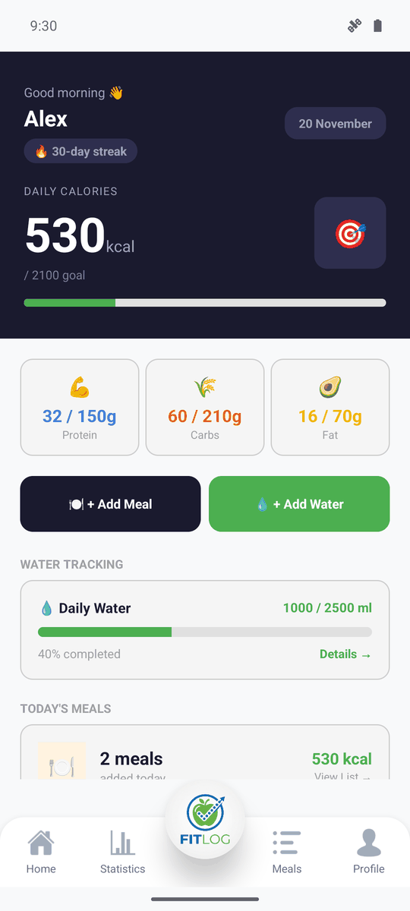
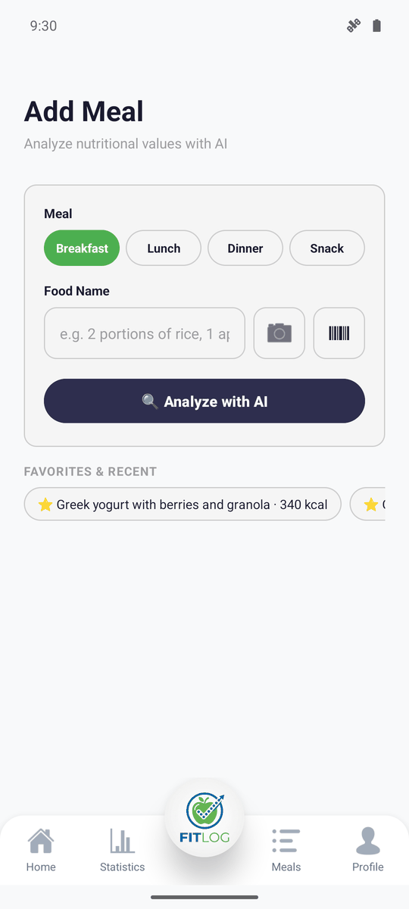
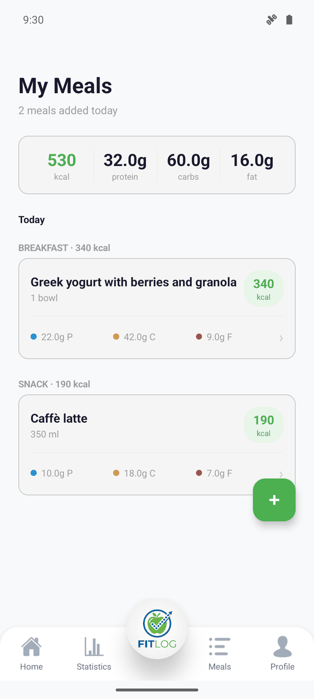
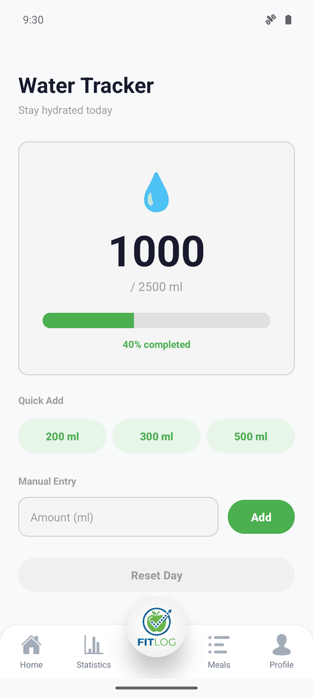
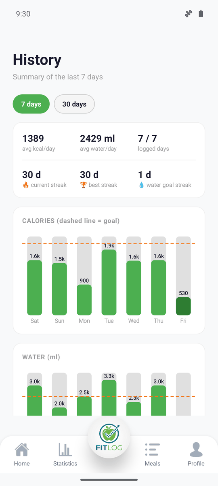
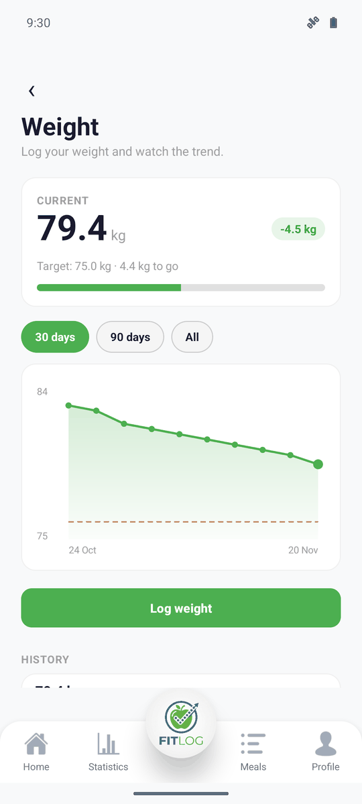
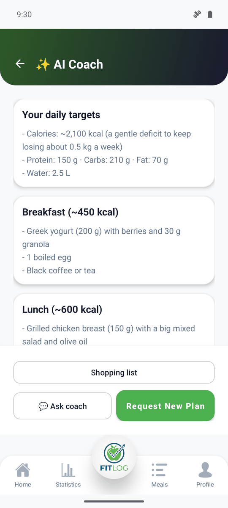
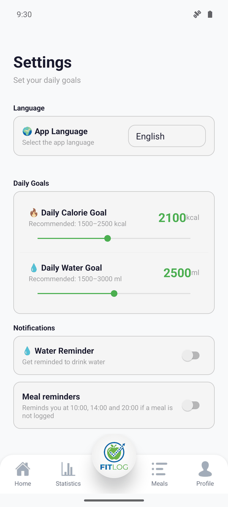
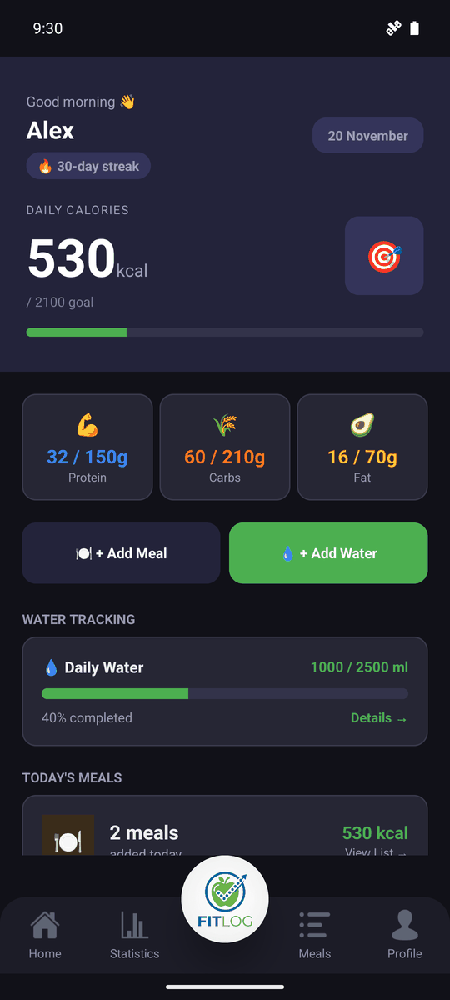
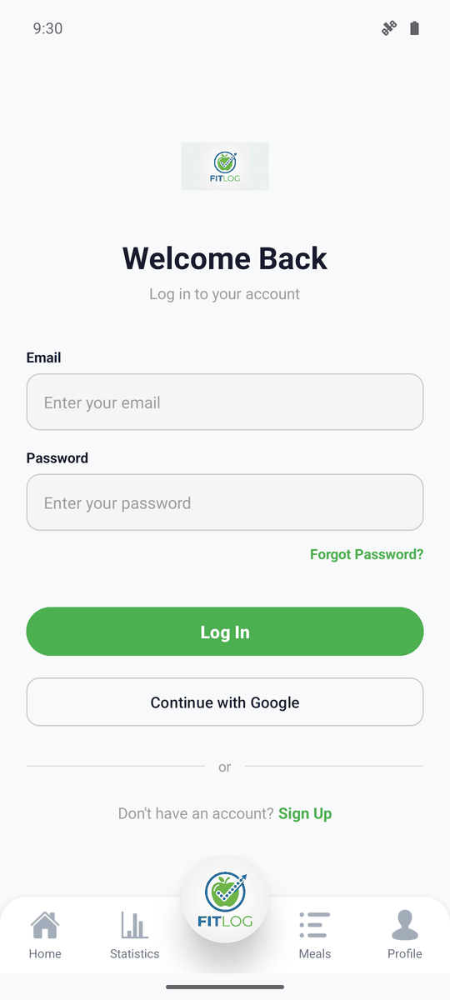

# FitLog 🏋️‍♂️🍏

🇬🇧 English · [🇹🇷 Türkçe](README.tr.md)

[](https://github.com/KaanKaya17/FitLog/actions/workflows/android.yml)
[](LICENSE)


FitLog is an AI-powered Android app for tracking food, water and weight. Log a meal with a photo, a sentence or a barcode. FitLog works out your goals from your profile, charts your progress, and gives you an AI coach that knows your last seven days.

The app is available in **English, Turkish and Greek**.

📘 **[Set up your own FitLog](docs/en/setup.md)** · 🧭 **[How the code works](docs/en/architecture.md)** · 🔒 **[Privacy policy](PRIVACY.md)**

## 🌟 Features

**Meal tracking**
- Nutrition analysis from a **photo**, a **text description** or a **barcode** (Open Food Facts), powered by Gemini 2.5 Flash
- Meal types (breakfast, lunch, dinner, snack), with the list grouped by type
- One-tap logging from **favourites and recent meals**
- Adjust the **portion** (½× to 2×) or edit the values before saving
- Log meals for past days

**Goals and progress**
- Automatic **calorie, macro and water goals** from your profile (Mifflin-St Jeor + activity level)
- **Weight tracking**: history, line chart, distance to your target, progress bar
- **History**: 7- and 30-day calorie and water charts, averages, current and best **streaks**

**Water**
- Quick add, **undo**, reset the day
- Reminders with adjustable frequency and **quiet hours**, restored after a reboot
- **"+250 ml" quick-settings tile**, so you can log water without opening the app
- **Home-screen widget** showing today's calories and water, with a one-tap +250 ml button

**Reminders**
- **Meal reminders** at 10:00, 14:00 and 20:00, only if that meal hasn't been logged yet (respects quiet hours)
- **Weekly summary** notification every Sunday at 20:00

**AI coach**
- A personalised daily plan built from your profile and your last 7 days
- **Chat** with the coach; the conversation stays in memory on your device
- A **shopping list** generated from the plan, grouped by category and shareable

**Account and app**
- Email/password and **Google sign-in** (Supabase Auth, PKCE)
- **Password reset** and **email confirmation** links open straight in the app
- **Privacy first**: analytics and crash reports stay off unless the user opts in
- **Delete your account** from inside the app (removes all data from the server)
- **Export your data** as CSV (meals, water, weight)
- **Works offline**: entries made without a connection are queued and synced later
- Light, dark and system themes

## 📱 Screenshots

<table>
  <tr>
    <td align="center"><br><sub>Home</sub></td>
    <td align="center"><br><sub>Add a meal</sub></td>
    <td align="center"><br><sub>Meals of the day</sub></td>
    <td align="center"><br><sub>Water</sub></td>
  </tr>
  <tr>
    <td align="center"><br><sub>History and streaks</sub></td>
    <td align="center"><br><sub>Weight trend</sub></td>
    <td align="center"><br><sub>AI coach</sub></td>
    <td align="center"><br><sub>Goals and reminders</sub></td>
  </tr>
  <tr>
    <td align="center"><br><sub>Dark theme</sub></td>
    <td align="center"><br><sub>Sign in</sub></td>
  </tr>
</table>

*Screenshots use a demo account with sample data.*

## 🔐 Security

- Passwords live only in Supabase Auth (bcrypt). The app never sees or compares them.
- **Row Level Security** on every table: users can only read and write their own rows, and blocked users are cut off on the server.
- **The Gemini key is not in the APK.** It lives in the `gemini-proxy` Edge Function, which checks the session, pins the model, and limits request size and daily usage.
- Tokens are stored with `EncryptedSharedPreferences`, and debug logs are stripped from release builds.

## 🛠️ Tech stack

Android (Java, minSdk 33) · Supabase (PostgreSQL, Auth, Edge Functions) · Gemini 2.5 Flash · Retrofit 2 & OkHttp 3 · AndroidX Lifecycle, Room, WorkManager, Navigation · ML Kit barcode scanner · Firebase Analytics, Crashlytics, FCM · Lottie

## 🚀 Quick start

```bash
git clone https://github.com/KaanKaya17/FitLog.git
```

1. Create a Supabase project and run the SQL files in [`supabase/migrations/`](supabase/migrations) in order (or `supabase db push`).
2. Add `fitlog://auth-callback` to **Authentication → URL Configuration → Redirect URLs**.
3. Deploy [`gemini-proxy`](supabase/functions/gemini-proxy) and set the `GEMINI_API_KEY` secret.
4. Put `google-services.json` in `app/`. Without Firebase, copy [`docs/google-services.placeholder.json`](docs/google-services.placeholder.json) there instead.
5. Add your project URL and anon key to `local.properties`:
   ```properties
   SUPABASE_URL=https://<project-ref>.supabase.co
   SUPABASE_API_KEY=<anon-or-publishable-key>
   ```
6. Run the app from Android Studio.

The **[setup guide](docs/en/setup.md)** walks through every step, including the dashboard-only route, Google sign-in, admin tasks and troubleshooting.

### Release signing (Play Store)

Don't commit your keystore (`*.jks` is git-ignored). Put its path and passwords in `local.properties`, or use environment variables with the same names in CI:

```properties
RELEASE_STORE_FILE=keystore/fitlog-release.jks
RELEASE_STORE_PASSWORD=...
RELEASE_KEY_ALIAS=fitlog
RELEASE_KEY_PASSWORD=...
```

`./gradlew bundleRelease` builds the AAB. If these values are missing, the release build is left unsigned.

### Tests

```bash
./gradlew testDebugUnitTest lintDebug
```

```bash
./gradlew connectedDebugAndroidTest
```

UI tests need a connected device or emulator, and they clear the local session on it.

## 🤝 Contributing

Issues and pull requests are welcome. Read **[How the code works](docs/en/architecture.md)** first; its last section lists the few rules: every new string in all three languages, database changes in a new idempotent migration, and tests passing.

## 📄 License

[MIT](LICENSE): use, change and share the code however you like, as long as you keep the license text.
