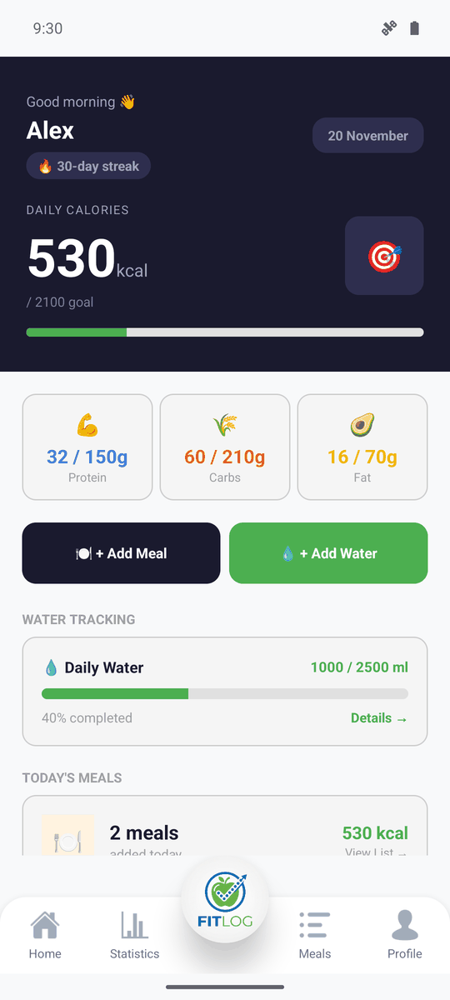
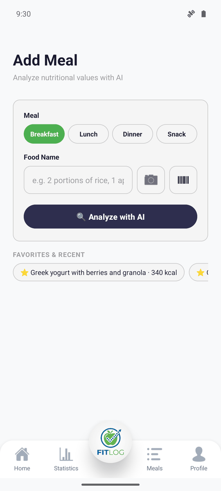
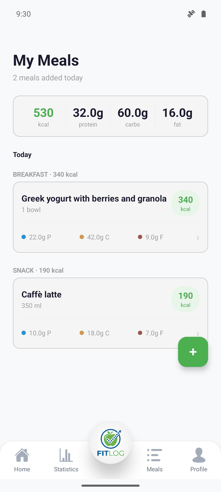
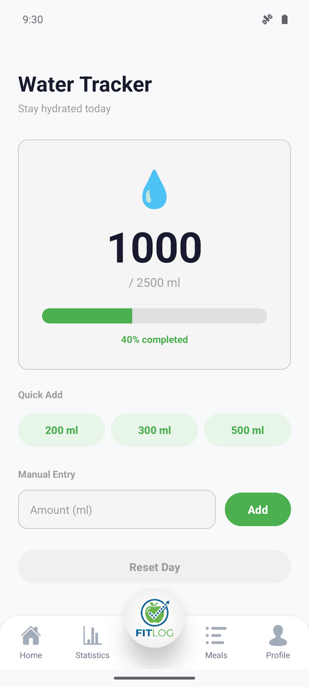
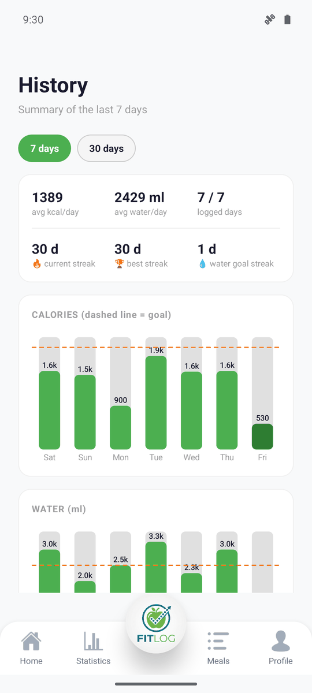
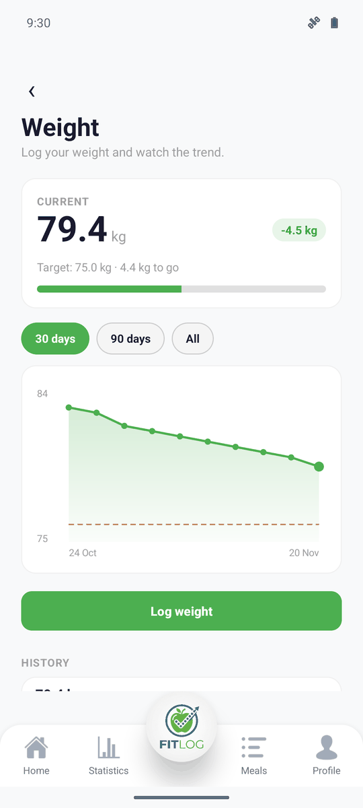
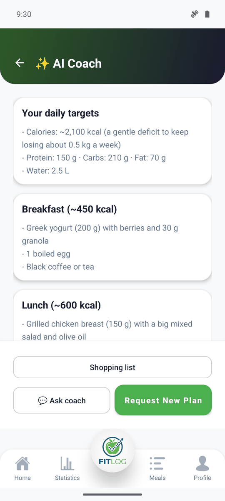
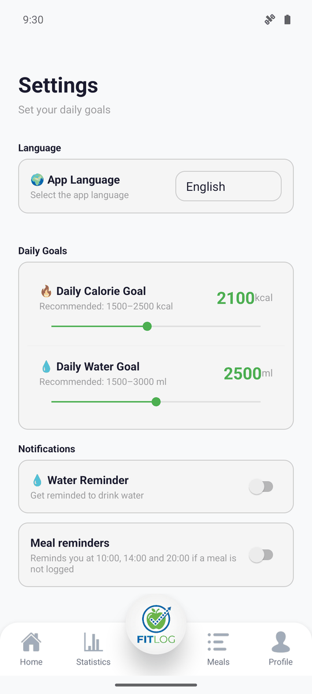
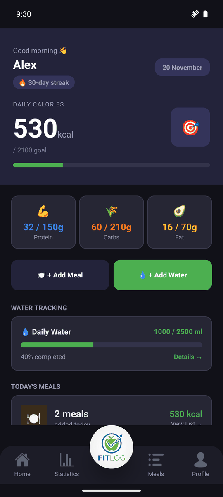
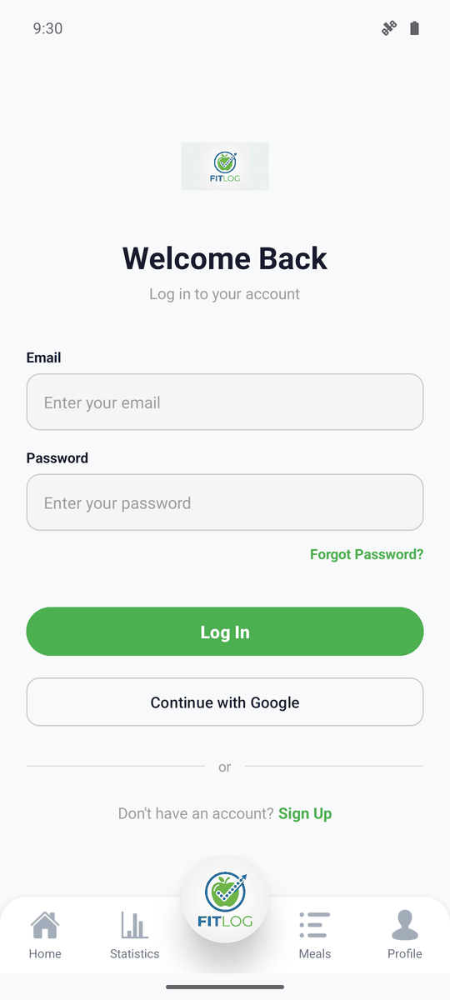

# FitLog 🏋️‍♂️🍏

[🇬🇧 English](README.md) · 🇹🇷 Türkçe

[](https://github.com/KaanKaya17/FitLog/actions/workflows/android.yml)
[](LICENSE)


FitLog, yapay zeka destekli bir Android beslenme, su ve kilo takip uygulamasıdır. Öğünlerini fotoğrafla, bir cümleyle ya da barkodla kaydedersin. FitLog hedeflerini profiline göre hesaplar, ilerlemeni grafiklerle gösterir ve son yedi gününü bilen bir AI koç sunar.

Uygulama **Türkçe, İngilizce ve Yunanca** kullanılabilir.

📘 **[Kendi FitLog'unu kur](docs/tr/kurulum.md)** · 🧭 **[Kod nasıl çalışır](docs/tr/mimari.md)** · 🔒 **[Gizlilik politikası](PRIVACY.md)**

## 🌟 Özellikler

**Öğün takibi**
- **Fotoğraf**, **metin** veya **barkod** (Open Food Facts) ile besin değeri analizi (Gemini 2.5 Flash)
- Öğün türü (kahvaltı, öğle, akşam, ara öğün) ve listede türe göre gruplama
- **Favoriler ve son yenenler** ile tek dokunuşla ekleme
- Kaydetmeden önce **porsiyonu** (½× – 2×) ayarlama ya da değerleri elle düzenleme
- Geçmiş bir güne öğün ekleme

**Hedefler ve ilerleme**
- Profile göre otomatik **kalori, makro ve su hedefi** (Mifflin-St Jeor + aktivite seviyesi)
- **Kilo takibi**: geçmiş, çizgi grafik, hedefe kalan ve ilerleme çubuğu
- **Geçmiş**: 7 ve 30 günlük kalori ve su grafikleri, ortalamalar, güncel ve en iyi **seri**

**Su**
- Hızlı ekleme, **geri al**, günü sıfırlama
- Sıklığı ayarlanabilen hatırlatmalar ve **sessiz saatler**; cihaz yeniden başlayınca hatırlatıcı yeniden kurulur
- Uygulamayı açmadan ekleme için **"+250 ml" hızlı ayar kutucuğu**
- **Ana ekran widget'ı**: bugünün kalori ve su ilerlemesi, tek dokunuşla +250 ml

**Hatırlatıcılar**
- **Öğün hatırlatıcısı**: kahvaltı, öğle ve akşam yemeği girilmemişse 10:00, 14:00 ve 20:00'de (sessiz saatlere uyar)
- Her pazar 20:00'de **haftalık özet** bildirimi

**AI Koç**
- Profilin ve son 7 günün verisiyle kişiselleştirilmiş günlük plan
- Koçla **sohbet**; konuşma yalnızca cihazın belleğinde tutulur
- Plandan **alışveriş listesi**: kategoriye göre gruplu ve paylaşılabilir

**Hesap ve uygulama**
- E-posta/şifre ve **Google ile giriş** (Supabase Auth, PKCE)
- **Şifre sıfırlama** ve **e-posta onayı** bağlantıları doğrudan uygulamayı açar
- **Önce gizlilik**: analitik ve hata raporları kullanıcı onay vermedikçe kapalı
- Uygulama içinden **hesap silme** (tüm veriler sunucudan silinir)
- **Verileri dışa aktarma**: öğün, su ve kilo geçmişi CSV olarak
- **Çevrimdışı çalışma**: bağlantı yokken yapılan kayıtlar kuyruğa alınır ve sonra gönderilir
- Açık, koyu ve sistem teması

## 📱 Ekran Görüntüleri

<table>
  <tr>
    <td align="center"><br><sub>Ana sayfa</sub></td>
    <td align="center"><br><sub>Öğün ekleme</sub></td>
    <td align="center"><br><sub>Günün öğünleri</sub></td>
    <td align="center"><br><sub>Su</sub></td>
  </tr>
  <tr>
    <td align="center"><br><sub>Geçmiş ve seriler</sub></td>
    <td align="center"><br><sub>Kilo grafiği</sub></td>
    <td align="center"><br><sub>AI koç</sub></td>
    <td align="center"><br><sub>Hedefler ve hatırlatıcılar</sub></td>
  </tr>
  <tr>
    <td align="center"><br><sub>Koyu tema</sub></td>
    <td align="center"><br><sub>Giriş</sub></td>
  </tr>
</table>

*Görüntülerde örnek verili bir demo hesap kullanıldı.*

## 🔐 Güvenlik

- Şifreler yalnızca Supabase Auth'ta (bcrypt) tutulur. Uygulama şifreleri görmez ve karşılaştırmaz.
- Her tabloda **Row Level Security**: kullanıcı yalnızca kendi satırlarını okuyup yazabilir; engellenen kullanıcıların erişimi sunucuda kesilir.
- **Gemini anahtarı APK'da değildir.** `gemini-proxy` Edge Function'ında durur; fonksiyon oturumu doğrular, modeli sabitler, istek boyutunu ve günlük kullanımı sınırlar.
- Token'lar `EncryptedSharedPreferences` ile saklanır; release derlemesinde debug logları silinir.

## 🛠️ Teknolojiler

Android (Java, minSdk 33) · Supabase (PostgreSQL, Auth, Edge Functions) · Gemini 2.5 Flash · Retrofit 2 & OkHttp 3 · AndroidX Lifecycle, Room, WorkManager, Navigation · ML Kit barkod tarayıcı · Firebase Analytics, Crashlytics, FCM · Lottie

## 🚀 Hızlı başlangıç

```bash
git clone https://github.com/KaanKaya17/FitLog.git
```

1. Bir Supabase projesi oluştur ve [`supabase/migrations/`](supabase/migrations) içindeki SQL dosyalarını sırayla çalıştır (ya da `supabase db push` kullan).
2. **Authentication → URL Configuration → Redirect URLs** listesine `fitlog://auth-callback` ekle.
3. [`gemini-proxy`](supabase/functions/gemini-proxy) fonksiyonunu yükle ve `GEMINI_API_KEY` secret'ını tanımla.
4. `google-services.json` dosyasını `app/` klasörüne koy. Firebase kullanmayacaksan bunun yerine [`docs/google-services.placeholder.json`](docs/google-services.placeholder.json) dosyasını oraya kopyala.
5. Proje URL'sini ve anon anahtarını `local.properties` dosyasına yaz:
   ```properties
   SUPABASE_URL=https://<proje-ref>.supabase.co
   SUPABASE_API_KEY=<anon-ya-da-publishable-anahtar>
   ```
6. Uygulamayı Android Studio'dan çalıştır.

**[Kurulum rehberi](docs/tr/kurulum.md)** her adımı anlatır: yalnızca panelle kurulum, Google ile giriş, yönetici işlemleri ve sorun giderme dahil.

### Release imzası (Play Store)

Keystore'u repoya koyma (`*.jks` git'e eklenmez). Yolunu ve şifrelerini `local.properties` dosyasına ya da CI'da aynı adlı ortam değişkenlerine yaz:

```properties
RELEASE_STORE_FILE=keystore/fitlog-release.jks
RELEASE_STORE_PASSWORD=...
RELEASE_KEY_ALIAS=fitlog
RELEASE_KEY_PASSWORD=...
```

`./gradlew bundleRelease` AAB dosyasını oluşturur. Bu değerler tanımlı değilse release derlemesi imzasız kalır.

### Testler

```bash
./gradlew testDebugUnitTest lintDebug
```

```bash
./gradlew connectedDebugAndroidTest
```

Arayüz testleri bağlı bir cihaz ya da emülatör ister ve o cihazdaki yerel oturumu sıfırlar.

## 🤝 Katkıda bulunma

Issue ve pull request'lere açığız. Önce **[Kod nasıl çalışır](docs/tr/mimari.md)** dokümanını oku; son bölümde birkaç kural var: her yeni metin üç dilde, veritabanı değişiklikleri yeni ve idempotent bir migration'da, testler geçiyor olmalı.

## 📄 Lisans

[MIT](LICENSE): kodu dilediğin gibi kullanabilir, değiştirebilir ve paylaşabilirsin; yalnızca lisans metnini koru.
